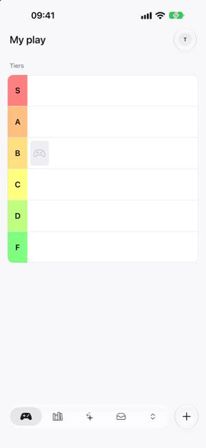
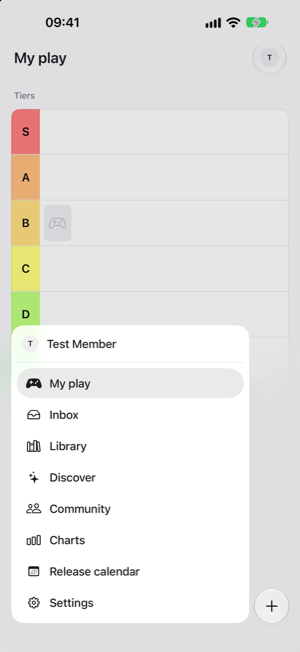
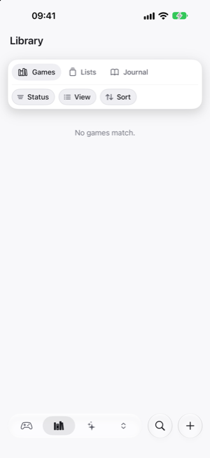
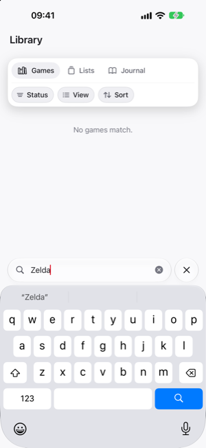

<h1 align="center">Float, damn dock!</h1>

<p align="center">
  A floating Liquid Glass tab bar for SwiftUI that you can scrub with a finger.
</p>

<p align="center">
  
  
  
</p>

<table align="center">
  <tr>
    <td align="center">
      <picture>
        <source media="(prefers-color-scheme: dark)" srcset=".github/media/bar-dark.png">
        
      </picture>
    </td>
    <td align="center">
      <picture>
        <source media="(prefers-color-scheme: dark)" srcset=".github/media/menu-dark.png">
        
      </picture>
    </td>
    <td align="center">
      <picture>
        <source media="(prefers-color-scheme: dark)" srcset=".github/media/library-dark.png">
        
      </picture>
    </td>
    <td align="center">
      <picture>
        <source media="(prefers-color-scheme: dark)" srcset=".github/media/search-dark.png">
        
      </picture>
    </td>
  </tr>
  <tr>
    <td align="center">The bar</td>
    <td align="center">The menu</td>
    <td align="center">A page with search</td>
    <td align="center">Searching</td>
  </tr>
</table>

Built for [Play, damn it!](https://playdamnit.com), where it replaces the system tab bar.

## Features

- **A glass pill of your main tabs.** Its last slot holds everything else: tap it and the pill grows into a menu of every tab.
- **Scrub.** Slide a finger across the bar or the menu. The highlight follows the finger, each tab you pass gives a haptic tick, and the tab opens when you lift the finger. Rest the finger on a tab and it opens right away.
- **Side bar on iPad.** At regular width the bar stands at the side of the pages. On an iPhone Duo it sits in the system's bar column.
- **Pages keep their state.** Every tab you opened stays alive, also when the bar moves between the bottom and the side.
- **Search like `searchable`.** A page offers its search, and the bar shows a search button for it. The field belongs to the page.
- **Every number can be tuned.** Colors, sizes, animations and gesture timings all live in one style, and each has a default.

## Installation

```swift
dependencies: [
  .package(url: "https://github.com/nezdemkovski/float-damn-dock", from: "0.1.0"),
],
targets: [
  .target(name: "App", dependencies: [
    .product(name: "FloatDamnDock", package: "float-damn-dock"),
  ]),
]
```

Requires iOS 26 and Swift 6.

## Quick start

```swift
import FloatDamnDock
import SwiftUI

enum Tab: Hashable, CaseIterable {
  case home, library, discover, inbox, settings
}

struct RootView: View {
  @State private var tab = Tab.home

  var body: some View {
    FloatDamnDockView(
      selection: $tab,
      pinned: [.home, .library, .discover, .inbox],
      menu: Tab.allCases
    ) { tab in
      FloatDamnDockItem(tab.title, systemImage: tab.symbol)
    } page: { tab in
      NavigationStack { page(for: tab) }
    }
  }
}
```

`pinned` are the tabs in the bar, and `menu` lists every tab in the menu's order. If the open tab is not pinned, it shows in the last slot.

## Guide

### Badges

```swift
FloatDamnDockItem("Inbox", systemImage: "tray", badge: unread, badgeLabel: "Unread")
```

The bar shows a dot and the menu shows the count. `badgeLabel` is what VoiceOver reads for the dot.

### Main action, reselect, menu header

```swift
FloatDamnDockView(...)
  .accessory("New post", systemImage: "plus") { composing = true }
  .onReselect { tab in paths[tab] = NavigationPath() }
  .menuHeader("Profile", isPresented: user != nil) {
    openProfile()
  } label: {
    ProfileRow(user: user)
  }
```

- `accessory` adds a round button beside the bar.
- `onReselect` runs when the user taps the tab that is already open, for example to pop back to the root.
- `menuHeader` adds a row above the tabs in the menu, for a place that is not a tab.

### Search

A page offers its search. The bar then shows a search button, and the page shows the field while it is open:

```swift
List(results) { … }
  .floatDamnDockSearch("Search games", text: $query, source: model)
```

`source` tells one page's search from another's. To draw the field yourself, use a style, the same way as with `ButtonStyle`:

```swift
struct BrandSearchField: FloatDamnDockSearchFieldStyle {
  func makeBody(configuration: FloatDamnDockSearchField) -> some View {
    MySearchField(
      configuration.prompt, text: configuration.text,
      onClose: configuration.close, onFocusChange: configuration.focusChanged
    )
  }
}

root.floatDamnDockSearchFieldStyle(BrandSearchField())
```

### Placement

```swift
FloatDamnDockView(...).placement(.automatic)  // .bottom, .side
```

`.automatic` puts the bar at the bottom at compact width and at the side at regular width.

### Pages under the bar

Scrolling pages run under the bottom bar, behind the scroll-edge blur. A page that does not scroll can keep clear of the bar with the space the environment gives it:

```swift
@Environment(\.floatDamnDockClearance) private var clearance
```

## Styling

Everything that can be tuned lives in `FloatDamnDockStyle`. Change only what you need, ideally in a preset of your own:

```swift
extension FloatDamnDockStyle {
  static var brand: Self {
    var style = Self()
    style.colors.highlight = .white.opacity(0.14)
    style.metrics.height = 56
    style.motion.menuOpen = .spring(duration: 0.3, bounce: 0.2)
    style.scrub.holdDuration = .milliseconds(300)
    return style
  }
}

root.floatDamnDockStyle(.brand)
```

| Group | What it holds |
| --- | --- |
| `colors` | Labels, the highlight, the light under the finger, the glass tint and its strength, the scrim, badges |
| `metrics` | Height, insets, gaps, paddings, icon sizes, the badge dot, the menu's rows and corners |
| `motion` | The press, the menu opening and closing, the icons and rows fading, the scrim, the search button |
| `scrub` | How long a rest takes to open a tab, how soon the highlight shows, what counts as a slide, the light |

The bar's own words (More, Search, Close) are English by default. Pass your own with `floatDamnDockLabels(_:)`.

## Scrub on its own

The finger gesture also works for any row of buttons:

```swift
HStack {
  ForEach(options) { option in
    OptionView(option).scrubItem(option.id)
  }
}
.scrubGroup(Option.ID.self, selected: selection, highlight: .capsule, follows: .finger) {
  selection = $0
}
```

## Accessibility

Every control keeps a real button for VoiceOver and keyboards, and Reduce Motion turns the animations off. UI tests can find the controls by these identifiers:

| Element | Identifier |
| --- | --- |
| Tab in the bar | `tabbar.<tab>` |
| Last slot | `tabbar.more` |
| Search button | `tabbar.search` |
| Accessory | `tabbar.<identifier>` |
| Menu row | `sections.<tab>` |
| Menu header | `sections.<identifier>` |

`<tab>` is `String(describing: tab)`, so for an enum it is the case name.
